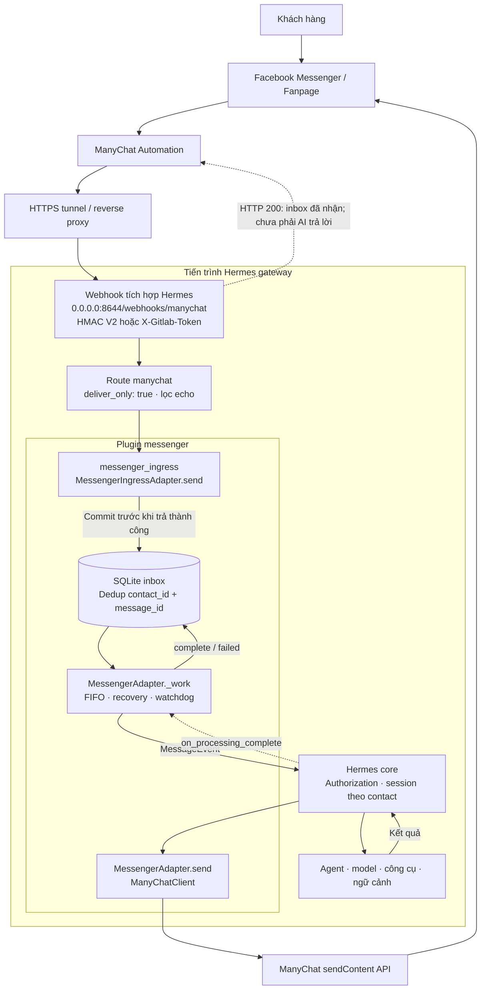

# Hướng dẫn cài đặt

Plugin dùng **webhook tích hợp Hermes trên port 8644**. Hai platform `messenger` và `messenger_ingress` không mở HTTP listener riêng.

Đặt plugin tại `<Hermes home>/plugins/messenger`, chạy trong thư mục plugin:

**Windows PowerShell**:

```powershell
.\setup.ps1
# Chỉ định runtime nếu cần:
.\setup.ps1 -HermesPython 'C:\path\to\hermes\venv\Scripts\python.exe'
```

**Linux / Git Bash**:

```sh
sh ./setup.sh
HERMES_PYTHON="$HOME/hermes-agent/venv/bin/python" sh ./setup.sh
```

Dùng `-HermesHome` hoặc `HERMES_HOME` để chọn profile/home khác. Mặc định Windows là `%LOCALAPPDATA%\hermes`, Linux là `~/.hermes`. Script kiểm tra/cài `aiohttp`, `ruamel.yaml` và `python-dotenv` còn thiếu vào Python Hermes đã chọn.

## Secret và migration

**Nguồn biến cấu hình duy nhất của setup là `.env.example`.** Điền token, secret và các biến mong muốn trong file này trước khi chạy setup. Script đồng bộ đúng các khóa/giá trị được khai báo vào `.env` Hermes, cập nhật khóa đã có và giữ nguyên các biến không thuộc template. Không đọc giá trị từ `.env` cục bộ của plugin, không lấy token/secret từ môi trường shell, không mở rộng `${VAR}` và không tự sinh secret hay thêm biến mặc định ngoài template. `HERMES_HOME`/`HERMES_PYTHON` chỉ dùng để tìm thư mục và runtime.

`MESSENGER_HERMES_WEBHOOK_SECRET` trong template được ghi vào route `platforms.webhook.extra.routes.manychat.secret`. `WEBHOOK_PORT` trong template quyết định port webhook. Khi thay giá trị, chỉnh `.env.example` rồi chạy lại setup. Không đưa template chứa thông tin thật lên repository công khai.

Script sao lưu `.env`/`config.yaml` đích trước khi ghi. Migration loại bỏ `MESSENGER_HOST`, `MESSENGER_PORT`, `MESSENGER_WEBHOOK_SECRET` và khóa listener cũ của platform Messenger, giữ database/token/cấu hình xử lý. Script bật webhook và ingress bridge, đặt port webhook 8644, thêm route `manychat`. Các route khác và global webhook secret được giữ nguyên. Nếu tên route `manychat` thuộc tích hợp khác, script từ chối thay vì ghi đè.

Script không restart gateway. Điền `MANYCHAT_API_TOKEN`, contact thử trong `MESSENGER_ALLOWED_USERS` và quyền `MESSENGER_ALLOW_ALL_USERS` trong `.env.example` theo nhu cầu, chạy setup, kiểm tra cấu hình rồi restart Hermes khi sẵn sàng. Các giá trị cài đặt lấy theo template. Nếu plugin đã bị chủ động tắt, chạy `hermes plugins enable messenger`.

## Gỡ cài đặt

Windows PowerShell:

```powershell
.\uninstall.ps1
# Có thể chỉ định runtime/home như setup:
.\uninstall.ps1 -HermesPython 'C:\path\to\hermes\venv\Scripts\python.exe' -HermesHome 'D:\hermes-profile'
```

Ubuntu / Linux:

```sh
sh ./uninstall.sh
# Nếu cần chỉ định runtime:
HERMES_PYTHON="$HOME/hermes-agent/venv/bin/python" sh ./uninstall.sh
```

Dừng Hermes gateway trước khi gỡ và đóng terminal/editor đang giữ file trong plugin. Uninstall sao lưu cấu hình rồi gỡ các biến Messenger/template khỏi `.env`, các platform `messenger`/`messenger_ingress`, mục plugin Messenger và route `manychat` thuộc bridge. Script **xóa vĩnh viễn** `<Hermes home>/plugins/messenger` và toàn bộ `<Hermes home>/plugin-data/messenger`, bao gồm database `inbox.sqlite`, file SQLite phụ trợ và metadata setup. Không giữ bản backup source sau khi hoàn tất.

Database tùy chỉnh được lấy từ `MESSENGER_DATABASE` trong `.env` Hermes hoặc `platforms.messenger.extra.database`. Đường dẫn này phải tuyệt đối. Với database ngoài thư mục dữ liệu Messenger, script kiểm tra schema inbox trước khi xóa database và các file `-wal`, `-shm`, `-journal`; từ chối database khác hoặc đường dẫn liên kết. Database phiên dùng chung của Hermes không bị xóa.

Plugin được chuyển tạm ra khỏi vùng discovery trước khi xóa. Nếu chuyển plugin thất bại, cấu hình được rollback. Nếu file bị khóa trong giai đoạn xóa, script báo lỗi và một phần dữ liệu có thể đã bị xóa. Đóng tiến trình giữ file rồi kiểm tra phần còn lại, kể cả thư mục tạm `plugin-backups/messenger-uninstalling`.

Setup lưu metadata tại `plugin-data/messenger/setup-state.json` để uninstall khôi phục cấu hình webhook dùng chung và `WEBHOOK_PORT` trước khi cài, nếu chúng chưa bị người vận hành đổi sau đó. Các route khác, global secret và tùy chỉnh mới được giữ lại. Nếu không có metadata từ setup phiên bản mới, uninstall giữ các thông số webhook dùng chung không xác định được chủ sở hữu. Backup cấu hình và thư viện Python dùng chung được giữ lại. Khởi động lại Hermes sau khi hoàn tất để unload plugin đang nằm trong bộ nhớ. Không chạy đồng thời với thao tác sửa/lưu cấu hình khác.

## Cấu hình được tạo

```yaml
plugins:
  enabled:
    - messenger
platforms:
  messenger:
    enabled: true
    extra:
      capacity: 1000
      retention_seconds: 604800
      timeout: 20
      processing_timeout: 600
  messenger_ingress:
    enabled: true
  webhook:
    enabled: true
    extra:
      host: 0.0.0.0
      port: 8644
      routes:
        manychat:
          secret: '<secret thực do setup chèn vào>'
          prompt: '{message}'
          deliver_only: true
          deliver: messenger_ingress
          deliver_extra:
            chat_id: '{contact_id}'
            thread_id: '{message_id}'
          filters:
            - field: is_echo
              not_equals: true
            - field: contact_id
              regex: '^[1-9][0-9]{0,29}$'
            - field: message
              regex: '\S'
```

Database mặc định: `<active Hermes home>/plugin-data/messenger/inbox.sqlite`. Chỉ chạy một adapter cho mỗi database. Hermes cần hỗ trợ route `deliver_only`, chuyển tiếp tới plugin platform, HMAC V2/token và completion hook của BasePlatformAdapter.

## ManyChat và kiểm tra thủ công

Đưa port 8644 ra HTTPS, cấu hình POST `/webhooks/manychat` và header `X-Gitlab-Token` chứa secret route. Không dùng header `X-Webhook-Secret` cũ. [ManyChat External Request](#manychat-external-request) mô tả payload, HMAC và retry.

Ví dụ PowerShell với contact thử; lệnh thực sự kích hoạt Agent và có thể gửi tin ManyChat:

```powershell
$body = @{contact_id='123456789'; message='Xin chào'; message_id=[guid]::NewGuid().ToString(); is_echo=$false} | ConvertTo-Json
Invoke-RestMethod -Method Post -Uri 'http://localhost:8644/webhooks/manychat' `
  -ContentType 'application/json; charset=utf-8' `
  -Headers @{'X-Gitlab-Token'=$env:MESSENGER_HERMES_WEBHOOK_SECRET} `
  -Body ([System.Text.Encoding]::UTF8.GetBytes($body))
```

Nạp secret vào shell trước khi thử; file `.env` không tự thiết lập biến cho PowerShell. HTTP `200 / delivered` nghĩa inbox đã nhận, chưa phải AI trả lời.

Chưa kiểm thử Fanpage/ManyChat thật hoặc chạy trên Linux thực tế. Test migration dùng Hermes home tạm; không tự thay đổi gateway đang hoạt động.

## Plugin đã triển khai

Plugin sử dụng **webhook tích hợp Hermes trên port 8644**, không mở listener riêng. Hermes core nhận và xác thực request; bridge nội bộ đưa tin vào SQLite inbox; worker Messenger giữ session theo contact ID và gửi phản hồi qua ManyChat.

### Kiến trúc đang triển khai



Plugin đăng ký hai platform: `messenger` quản lý hội thoại/phản hồi và `messenger_ingress` làm bridge nhận tin đã xác thực. Route dùng `deliver_only: true` để webhook Hermes không tạo thêm một lượt Agent; chỉ worker Messenger xử lý hội thoại. Manifest dùng `kind: standalone` để đăng ký cả hai platform trước khi đọc cấu hình.

### Cài đặt

Setup lấy secret từ `.env.example`, đồng bộ vào `.env` Hermes và route `manychat` trong cấu hình Hermes. Xem phần cài đặt ở đầu tài liệu này.

### ManyChat External Request

Gửi POST tới `https://your-domain.example/webhooks/manychat`, trỏ về Hermes port **8644**. Đặt `Content-Type: application/json` và **`X-Gitlab-Token: <secret route manychat>`**. Đây là header token bộ xác thực Hermes hỗ trợ trực tiếp; không cần một dịch vụ GitLab riêng.

```json
{
  "contact_id": "123456789",
  "message": "Xin chào",
  "message_id": "stable-inbound-message-id",
  "is_echo": false
}
```

Ánh xạ biến có thật trong Automation. `contact_id` là ManyChat subscriber/contact ID, không phải Facebook PSID. `message` phải là chuỗi văn bản, `is_echo` là boolean. Bỏ `message_id` nếu flow không có khóa ổn định theo từng tin; có ID thì inbox chống trùng theo cặp contact/message ID. Không dùng nội dung câu hỏi hoặc chỉ contact ID làm khóa.

**Không đặt `X-Request-ID` cố định trong ManyChat.** Nếu không có header, Hermes tạo delivery ID mới cho mỗi request. Nếu tự quản lý, dùng ID mới cho mỗi lần thử HTTP và giữ `message_id` trong body ổn định. Runtime Hermes hiện tại ghi nhớ delivery ID trước khi chuyển tiếp `deliver_only`: thử lại ID của một lần chuyển tiếp thất bại có thể nhận `duplicate` dù inbox chưa nhận tin.

Header cũ `X-Webhook-Secret` không còn được chấp nhận. Client tự ký request có thể dùng **HMAC V2** thay cho token:

```text
X-Webhook-Timestamp: <Unix timestamp nguyên theo giây>
X-Webhook-Signature-V2: hex(HMAC-SHA256(secret, timestamp + "." + raw_body))
```

Tính chữ ký trên đúng byte body gửi đi. Hermes từ chối timestamp ngoài cửa sổ 300 giây. Dùng HTTPS cho cả hai cách. Không gửi token header khi kiểm tra HMAC, vì Hermes có thể chọn xác thực token trước.

### Trạng thái và phục hồi

| HTTP / trạng thái | Ý nghĩa |
|---|---|
| 200 / delivered | Bridge đã commit inbox; chưa phải AI hay Messenger giao tin. |
| 200 / ignored | Route lọc tin, chẳng hạn echo/contact ID không hợp lệ. |
| 200 / duplicate | Delivery ID đã được Hermes ghi nhận; xem lưu ý retry. |
| 401 | Token/chữ ký sai, thiếu hoặc timestamp không hợp lệ. |
| 403 | Route thiếu secret hợp lệ. |
| 429 | Rate limit của webhook Hermes. |
| 502 | Bridge không sẵn sàng, payload bị từ chối, inbox đầy/lỗi hoặc ID xung đột. |

Các lỗi body/route khác tuân theo webhook Hermes. Health listener dùng `/health`; không chứng minh worker Messenger hoặc ManyChat API đang hoạt động. Worker lỗi/watchdog hết hạn khiến bridge từ chối nhận tin mới bằng lỗi 502, giữ tin chưa hoàn tất để kiểm tra.

Worker chờ completion hook trước khi lấy tin tiếp theo. Authorization vẫn qua Messenger platform; xác thực webhook không tự bỏ qua allowlist. Chỉ chạy một adapter cho mỗi database. Phục hồi processing sau crash vẫn có thể gửi trùng nếu API đã nhận tin trước lúc ghi complete; không cam kết exactly-once. Client chỉ tự retry 429; không phát lại mù timeout/5xx hoặc đoạn đã gửi. Plugin không tạo thêm outbound delivery obligation Hermes cho phản hồi Messenger.

### Kiểm thử

```powershell
..\..\hermes-agent\venv\Scripts\python scripts\test_with_hermes.py ..\..\hermes-agent
```

Kiểm thử dùng handler và xác thực webhook thật của Hermes, HTTP ManyChat giả, SQLite và BasePlatformAdapter thật. Chưa kiểm chứng Fanpage/ManyChat end-to-end thật. Runner không sửa profile/gateway đang hoạt động.

### Tài liệu

- [Hướng dẫn cài đặt](INSTALLATION.md)
- [ManyChat API](https://api.manychat.com/swagger#/)
- [Đặc tả ban đầu](system-design/implementation-spec.md) và [nhật ký thay đổi](system-design/progress.md). Mô tả listener riêng trong đặc tả cũ là kiến trúc trước migration.
