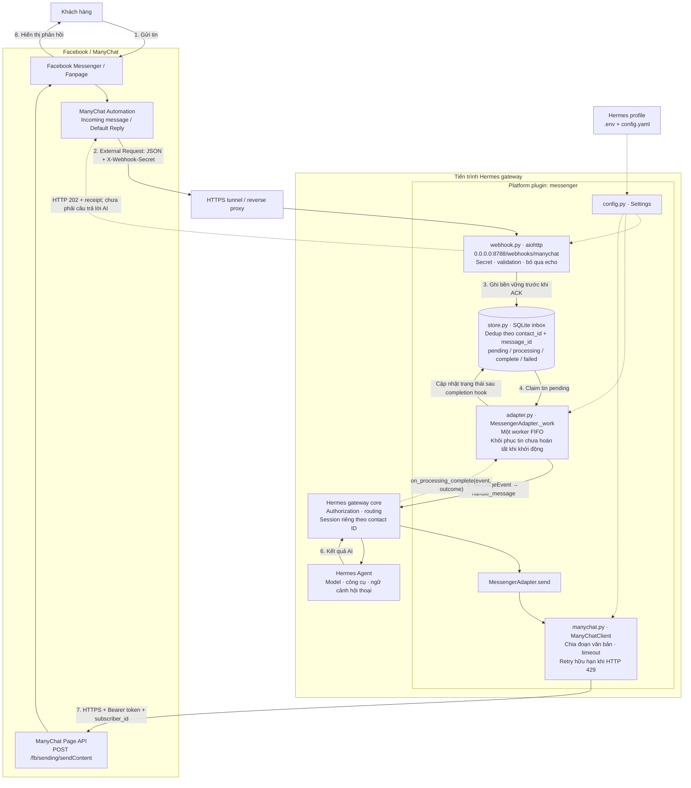

# Build facebook messenger chatbot

Xây dựng một hermes plugin platform hỗ trợ xây dựng facebook messenger chatbot dựa trên sự kết hợp của hermes và [manychat](https://manychat.com/)

## Hermes agent skill

- [hermes-agent](https://github.com/NousResearch/hermes-agent/blob/main/skills/autonomous-ai-agents/hermes-agent/SKILL.md)

## Kiến trúc hệ thống

[system-design](./system-design/architecture.md)

## Hướng dẫn build một hermes plugin

- [built-in-plugins](https://github.com/NousResearch/hermes-agent/blob/main/website/docs/user-guide/features/built-in-plugins.md)
- [user-guide/plugins](https://github.com/NousResearch/hermes-agent/blob/main/website/docs/user-guide/features/plugins.md)
- [developer-guide/plugins](https://github.com/NousResearch/hermes-agent/blob/main/website/docs/developer-guide/plugins/index.md)

## Ví dụ

- [hermes-example-plugins](https://github.com/NousResearch/hermes-example-plugins)

## ManyChat api

- [ManyChat API](https://api.manychat.com/swagger#/)

## Plugin đã triển khai

Plugin platform `messenger` nhận văn bản bằng ManyChat External Request, đưa vào SQLite rồi chuyển vào Hermes gateway. Agent, model, công cụ và lịch sử hội thoại dùng cấu hình Hermes hiện có. Mỗi ManyChat contact là một DM riêng. Bản đầu hỗ trợ một kết nối ManyChat/Fanpage trên mỗi adapter, trả lời bất đồng bộ, không cần polling hoặc n8n.

### Kiến trúc plugin đang triển khai



Plugin được nạp từ [plugin.yaml](plugin.yaml) qua `register(ctx)` và đăng ký platform `messenger`; webhook, worker và HTTP client chạy trong cùng tiến trình gateway. Hermes core quản lý quyền truy cập, session và Agent; plugin quản lý tiếp nhận, lưu hàng đợi và giao tiếp ManyChat.

Webhook trả **202 sau khi commit SQLite**, còn câu trả lời được gửi riêng bằng ManyChat API. Worker chờ completion hook thật trước khi lấy tin tiếp theo. `complete` là trạng thái xử lý của gateway, không phải xác nhận Facebook đã giao tin; phục hồi sau crash vẫn có khả năng gửi trùng. Nếu worker lỗi hoặc quá thời gian watchdog, ingress trả **503** và giữ tin chưa hoàn tất để kiểm tra.

### Cài đặt

Xem [hướng dẫn cài đặt](INSTALLATION.md) cho Windows và Linux.

### HTTPS và ManyChat Automation

Listener mặc định bind `0.0.0.0:8788` trên mọi giao diện IPv4. Dùng HTTPS tunnel hoặc reverse proxy để cung cấp URL HTTPS cho ManyChat. Địa chỉ công khai chỉ cần chuyển tiếp route webhook; không mở API quản trị Hermes. Health endpoint có thể giữ nội bộ. Không ghi header secret trong access log của proxy.

Trong ManyChat đã kết nối đúng Facebook Page:

1. Chọn trigger/Default Reply phù hợp và bảo đảm flow lấy được văn bản mới nhất của khách. Nếu không có biến văn bản trong trigger, dùng bước thu thập input/lưu custom field phù hợp trước khi gửi External Request.
2. Thêm External Request với phương thức **POST**, URL `https://your-domain.example/webhooks/manychat`.
3. Đặt `Content-Type: application/json` và `X-Webhook-Secret: <secret thực>`.
4. Ánh xạ payload dưới đây bằng bộ chọn biến của ManyChat. Các chuỗi viết hoa là chỗ cần thay, không phải tên biến mà plugin bảo đảm ManyChat có.
5. Không thêm bước gửi lại phản hồi AI từ JSON của webhook: endpoint chỉ trả receipt; adapter sẽ gửi câu trả lời qua API riêng. Kiểm tra flow không kích hoạt lại từ chính tin bot gửi.

```json
{
  "contact_id": "REPLACE_WITH_MANYCHAT_CONTACT_ID",
  "channel": "facebook",
  "message": "REPLACE_WITH_ACTUAL_INBOUND_TEXT",
  "message_id": "REPLACE_WITH_STABLE_INBOUND_EVENT_ID",
  "is_echo": false
}
```

`contact_id` là ManyChat subscriber/contact ID, không phải Facebook PSID. Phải là số nguyên dương hoặc chuỗi chữ số ASCII, tối đa 30 chữ số. `message` là văn bản UTF-8 hợp lệ, không rỗng, tối đa 10.000 ký tự; tổng body tối đa 64 KiB.

`message_id` tùy chọn, chuỗi tối đa 256 ký tự. Chỉ gửi nếu flow có khóa ổn định theo **từng tin nhận**; nếu không, bỏ trường này. Không tạo ID từ contact ID hoặc nội dung câu hỏi. Không có ID thì mỗi request được xử lý riêng và không có bảo đảm chống trùng. `timestamp` hoặc trường phụ không tham gia khóa idempotency. Payload được normalize trước khi dedup; khóa là cặp contact/message ID.

Đây là chatbot phản hồi tin khách vừa gửi, trong messaging window hợp lệ. Plugin không tự gắn `ACCOUNT_UPDATE` hoặc tag khác để vượt cửa sổ nhắn tin. Cần kiểm tra quyền Page API, quyền gửi, gói ManyChat hỗ trợ External Request/API và trigger trên tài khoản thật. API từ chối gửi ngoài quyền/window sẽ được báo lỗi, không tự đổi tag.

### Phản hồi HTTP và trạng thái

| HTTP | Ý nghĩa |
|---|---|
| 202 | Đã commit vào SQLite; JSON gồm `status`, `id`, `duplicate`. Chưa phải AI đã trả lời. |
| 200 / ignored | Echo hợp lệ được bỏ qua. |
| 400 | JSON/payload sai. |
| 401 | Secret thiếu hoặc sai. |
| 409 | Cùng contact/message ID nhưng nội dung khác. |
| 413 | Body vượt 64 KiB. |
| 503 | Inbox đầy, database lỗi hoặc worker ngừng; có thể gửi lại sau khi khắc phục. |

`GET /healthz` trả 200 khi listener/worker sẵn sàng, 503 khi worker đã dừng do lỗi hoặc watchdog. Đây là health của adapter, không xác minh token ManyChat, model hay việc khách đã đọc tin.

SQLite có trạng thái `pending` → `processing` → `complete` hoặc `failed`. `complete` nghĩa gateway kết thúc thành công; có thể là xử lý không tạo phản hồi. ManyChat trả `status=success` chỉ chứng minh API chấp nhận gửi, không phải bằng chứng Facebook giao tin. Không có delivery receipt/message ID giả được tạo ra.

Worker xử lý FIFO và chờ completion hook thật trước khi lấy tin tiếp theo. Watchdog mặc định 600 giây: nếu không nhận hoàn tất, adapter ngừng nhận mới bằng 503 và giữ tin đang xử lý để kiểm tra. Khi dừng gateway, tin pending/processing được giữ lại; khởi động sau sẽ phục hồi processing về pending. **Nếu tiến trình chết sau lúc gửi nhưng trước lúc ghi complete, phản hồi có thể bị gửi trùng khi phục hồi.** Kiểm tra ManyChat trước khi restart một lần xử lý có kết quả không rõ.

Client chia văn bản dài thành đoạn tối đa 2.000 UTF-16 units; retry tối đa ba lần tổng cộng cho 429, tôn trọng Retry-After tối đa 30 giây chờ inline. Penalty dài hơn trả `rate_limited`, không thử sớm. Timeout, 5xx và phản hồi không đọc được được xem là kết quả chưa rõ, không tự gửi lại. Gateway fallback/retry được chặn; riêng Messenger không tạo outbound delivery obligation của Hermes để tránh thêm một cơ chế phát lại toàn bộ phản hồi khi boot. SQLite inbox là lớp phục hồi của plugin; giới hạn trùng khi crash vẫn áp dụng như mô tả ở trên.

Lỗi agent hoặc gửi tin được lưu `failed`; không tự chạy lại bằng cùng message ID. Muốn xử lý lại, người vận hành kiểm tra kết quả trên ManyChat rồi gửi lại nội dung với một message ID mới. Payload của bản ghi hoàn tất/thất bại được xóa, giữ digest/khóa dedup trong thời gian retention (mặc định 7 ngày); sau retention, request cũ có thể được xử lý lại. Bản ghi đang chờ không bị prune. Giới hạn 1.000 mặc định tính pending + processing, không phải tổng số lịch sử. File SQLite vẫn chứa contact ID trong khóa dedup và có thể giữ byte cũ trong WAL/free pages; bảo vệ quyền truy cập, ổ đĩa và backup như dữ liệu khách hàng.

### Thử webhook bằng PowerShell

Sau khi gateway chạy với secret trong shell hiện tại, dùng contact thử đã được cho phép:

`0.0.0.0` là địa chỉ bind; kết nối từ cùng máy dùng `localhost`, từ máy khác dùng IP hoặc tên miền của máy chạy Hermes.

```powershell
$body = @{
  contact_id = '123456789'
  message = 'Xin chào'
  message_id = [guid]::NewGuid().ToString()
} | ConvertTo-Json
Invoke-RestMethod -Method Post -Uri 'http://localhost:8788/webhooks/manychat' `
  -ContentType 'application/json; charset=utf-8' `
  -Headers @{ 'X-Webhook-Secret' = $env:MESSENGER_WEBHOOK_SECRET } `
  -Body ([System.Text.Encoding]::UTF8.GetBytes($body))
```

Lệnh này thực sự kích hoạt agent và có thể gửi tin tới contact đó. Chỉ chạy với contact thử của bạn.

### Kiểm thử

Kiểm thử thông thường không gọi ManyChat thật:

```powershell
python -m venv .venv
.\.venv\Scripts\python -m pip install -r requirements-dev.txt
.\.venv\Scripts\python -m pytest
```

Các test adapter được skip nếu runtime không có Hermes. Để kiểm tra đầy đủ với gateway thật, dùng Python của Hermes và cung cấp đường dẫn source:

```powershell
..\..\hermes-agent\venv\Scripts\python scripts\test_with_hermes.py ..\..\hermes-agent
```

Runner dùng Hermes home tạm, không dùng token thật, không enable plugin hoặc restart gateway hiện tại. Cài `requirements-dev.txt` vào môi trường test dùng runtime Hermes nếu thiếu pytest; trên Windows runner cũng tìm test dependencies trong `.venv` cục bộ sau các thư viện của runtime.

Đã kiểm thử: 43 test thành công với runtime Hermes thật, gồm admission HTTP, validation, echo, dedup/conflict, capacity/retention, phục hồi SQLite, client HTTP giả, phân đoạn Unicode, retry và timeout, lifecycle/port conflict/watchdog, routing và completion với BasePlatformAdapter thật, PluginContext và PluginManager thật; installer được kiểm tra gộp cấu hình, backup, chạy lại không đổi file và từ chối YAML sai trước khi ghi. Validator chính thức của Hermes qua 15 kiểm tra ở phiên bản plugin trước khi thêm installer. **Chưa kiểm thử end-to-end trên Fanpage/ManyChat thật** vì chưa cấu hình credential và Automation thực tế.

### Nguồn API đã đối chiếu

- [Hermes platform adapter](https://github.com/NousResearch/hermes-agent/blob/main/website/docs/developer-guide/adding-platform-adapters.md) và source runtime đang cài.
- [ManyChat Page API OpenAPI](https://api.manychat.com/swagger/compileJson?type=Page_API): `POST /fb/sending/sendContent`, Bearer, integer `subscriber_id`, object `data`, JSON `status=success`; kiểm tra ngày 2026-10-22.
- [ManyChat Facebook response format](https://manychat.github.io/dynamic_block_docs/): `v2` và `content.messages` dạng văn bản.
- [ManyChat message length guidance](https://help.manychat.com/hc/en-us/articles/14281251371164-ChatGPT-integration): giới hạn Messenger 2.000 ký tự; client dùng UTF-16 units để chia bảo thủ với emoji.

Thiết kế và kế hoạch: [đặc tả](system-design/implementation-spec.md), [kế hoạch](system-design/implementation-plan.md), [nhật ký kiểm chứng](system-design/progress.md).
