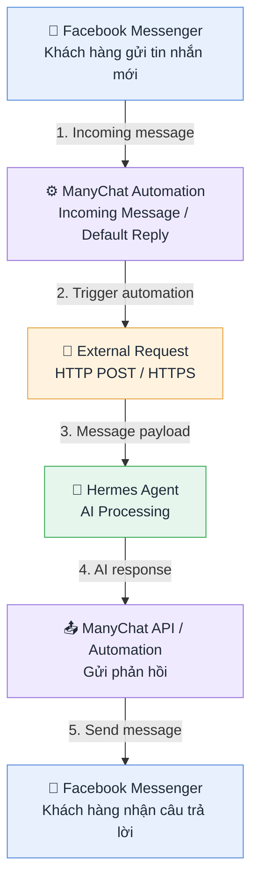
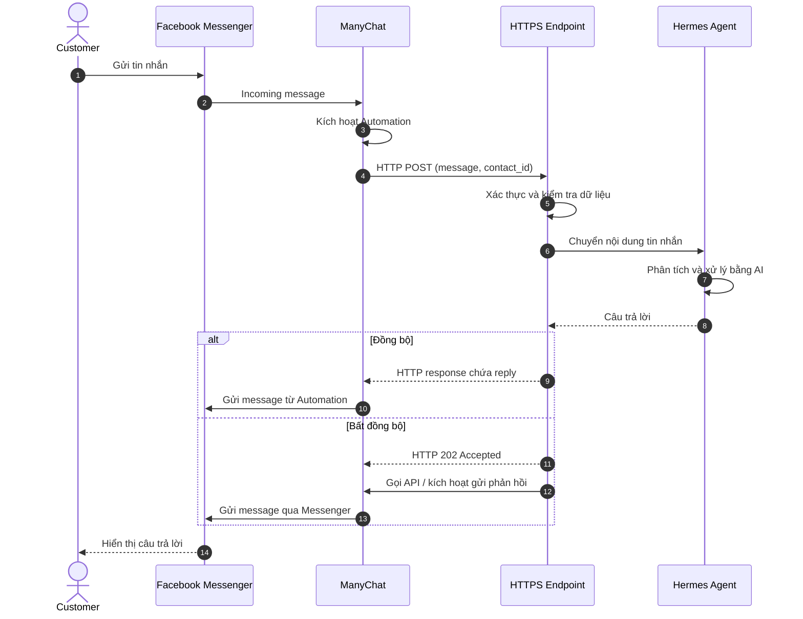
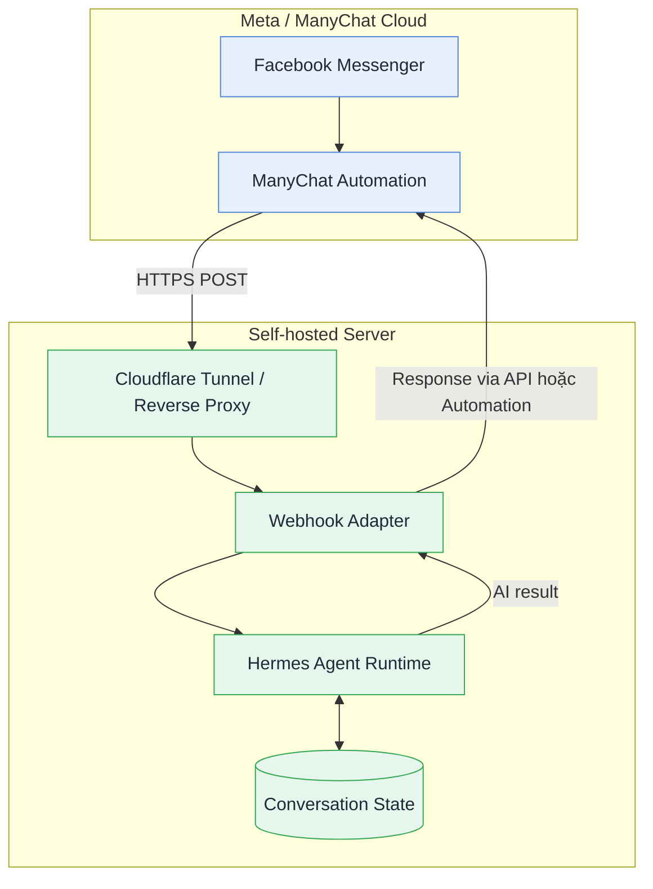

# Kiến trúc hệ thống Facebook Messenger – ManyChat – Hermes Agent

## 1. Tổng quan hệ thống

Hệ thống được thiết kế nhằm **tự động phát hiện tin nhắn mới từ Facebook Messenger, chuyển nội dung đến Hermes Agent để xử lý bằng AI, sau đó gửi phản hồi trở lại người dùng thông qua ManyChat**.

**Mục tiêu:**

- Nhận và xử lý tin nhắn Messenger gần thời gian thực, không cần polling.
- Sử dụng ManyChat Automation làm cơ chế kích hoạt (trigger).
- Tích hợp Hermes Agent để phân tích nội dung và tạo câu trả lời.
- Trao đổi dữ liệu thông qua HTTP API/Webhook.
- Không yêu cầu n8n hay nền tảng workflow trung gian.

## 2. Sơ đồ khối kiến trúc



## 3. Mô tả các thành phần

| Thành phần | Vai trò | Công nghệ/Giao thức |
|---|---|---|
| Facebook Messenger | Kênh giao tiếp giữa khách hàng và doanh nghiệp | Meta Messenger Platform |
| ManyChat Automation | Phát hiện tin nhắn mới và kích hoạt luồng xử lý | Incoming Message / Default Reply Trigger |
| External Request | Gửi dữ liệu từ ManyChat đến dịch vụ AI | HTTPS POST, JSON |
| Hermes Agent | Phân tích tin nhắn, xử lý logic, tạo phản hồi | LLM, Tools, Agent Runtime |
| ManyChat API / Automation | Đưa câu trả lời trở lại hội thoại | REST API / Automation |
| Facebook Messenger (đầu ra) | Hiển thị phản hồi cho khách hàng | Messenger Platform |

### 3.1. Facebook Messenger

Là kênh giao tiếp đầu vào và đầu ra. Khi khách hàng gửi tin nhắn đến Fanpage, Messenger chuyển sự kiện đến ManyChat thông qua kết nối với Meta. Dữ liệu có thể bao gồm nội dung văn bản, mã định danh người gửi và thông tin hội thoại được ManyChat hỗ trợ.

### 3.2. ManyChat Automation

Kích hoạt Automation bằng trigger phù hợp như Incoming Message hoặc Default Reply:

1. Tiếp nhận sự kiện tin nhắn.
2. Xác định Automation cần thực thi.
3. Thu thập các trường dữ liệu được hỗ trợ.
4. Gọi bước External Request.

> **Lưu ý:** Cần kiểm tra khả năng truy xuất nguyên văn tin nhắn trong flow. Trigger không mặc nhiên bảo đảm bắt được mọi tin nhắn hoặc mọi loại nội dung.

### 3.3. External Request — HTTP POST

Kết nối ManyChat với Hermes qua endpoint HTTPS, ví dụ:

```http
POST https://agent.example.com/webhooks/manychat
Content-Type: application/json
```

Ví dụ payload do người triển khai ánh xạ từ các biến sẵn có:

```json
{
  "contact_id": "123456789",
  "channel": "facebook",
  "message": "Cho tôi hỏi giá sản phẩm?",
  "timestamp": "2026-10-22T10:00:00+07:00"
}
```

Đây là **payload minh họa**, không phải định dạng mặc định mà ManyChat bảo đảm cung cấp.

### 3.4. Hermes Agent

Hermes Agent đảm nhiệm:

- Phân tích ý định khách hàng.
- Truy xuất knowledge base hoặc công cụ tích hợp.
- Duy trì ngữ cảnh theo contact ID.
- Sinh câu trả lời theo LLM và quy tắc vận hành.

Ví dụ kết quả:

```json
{
  "contact_id": "123456789",
  "reply": "Sản phẩm hiện có giá 500.000 VNĐ."
}
```

Để kết nối, Hermes cần có endpoint/adapter tiếp nhận HTTP request, xác thực nguồn gửi và chuyển dữ liệu vào Agent Runtime.

### 3.5. ManyChat API / Automation

Có hai cách trả lời:

| Mô hình | Cách hoạt động |
|---|---|
| Đồng bộ (Synchronous) | External Request nhận phản hồi trực tiếp; Automation tiếp tục gửi tin. |
| Bất đồng bộ (Asynchronous) | Endpoint nhận sự kiện; Hermes xử lý riêng và gửi phản hồi sau thông qua API/Automation phù hợp. |

Đồng bộ đơn giản hơn nhưng chịu giới hạn timeout của External Request. Bất đồng bộ phù hợp khi cần gọi nhiều công cụ hoặc xử lý lâu. Mọi phản hồi cần tuân thủ quyền Messenger, giới hạn API và chính sách nhắn tin của Meta.

## 4. Sơ đồ tuần tự (Sequence Diagram)



## 5. Yêu cầu kỹ thuật

| Hạng mục | Yêu cầu |
|---|---|
| Kết nối | Endpoint HTTPS truy cập được từ Internet |
| Xác thực | API key/secret header hoặc phương án tương đương |
| Payload | JSON chứa contact ID và nội dung tin nhắn nếu truy xuất được |
| Chống trùng lặp | Message ID hoặc khóa idempotency nếu có |
| Timeout | Tuân thủ giới hạn External Request của ManyChat |
| Retry | Xử lý gửi lại khi dịch vụ AI lỗi hoặc không phản hồi |
| Bảo mật | Không ghi log token; hạn chế dữ liệu cá nhân |
| Hội thoại | Ánh xạ contact ID với conversation/session của Hermes |
| Chống vòng lặp | Không xử lý lại tin do chính bot gửi |
| Mở rộng | Queue và worker nếu lưu lượng tăng |

## 6. Sơ đồ triển khai (Deployment Architecture)



## 7. Khuyến nghị triển khai

Bắt đầu với **ManyChat External Request → HTTPS Adapter → Hermes Agent → ManyChat Automation**. Nếu thời gian xử lý vượt giới hạn request, chuyển sang mô hình bất đồng bộ.

Không nên mở trực tiếp API quản trị Hermes ra Internet. Nên đặt adapter có xác thực phía sau Cloudflare Tunnel hoặc reverse proxy, thêm kiểm soát truy cập, timeout, retry, chống trùng lặp và log tối thiểu. Kiểm thử thực tế các trigger, biến tin nhắn, quyền API và chính sách Messenger trước khi chạy production.
